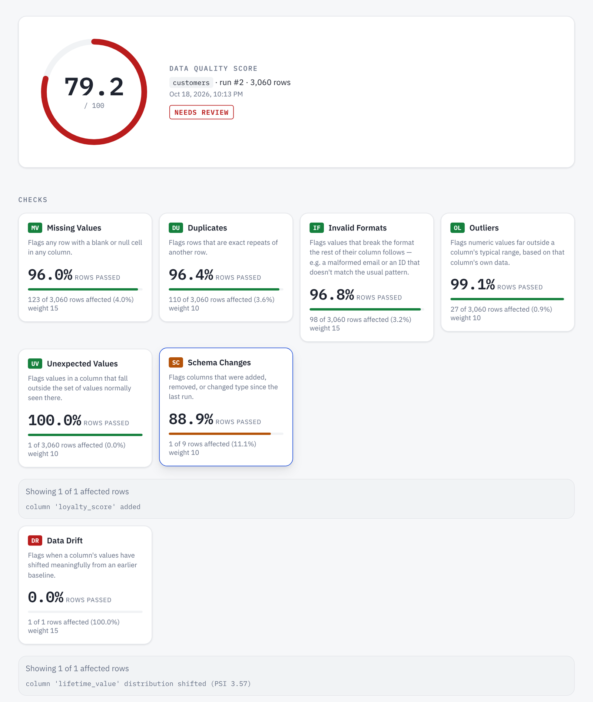
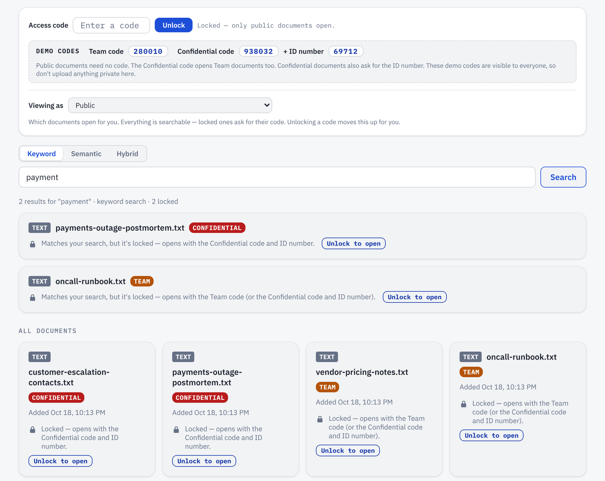
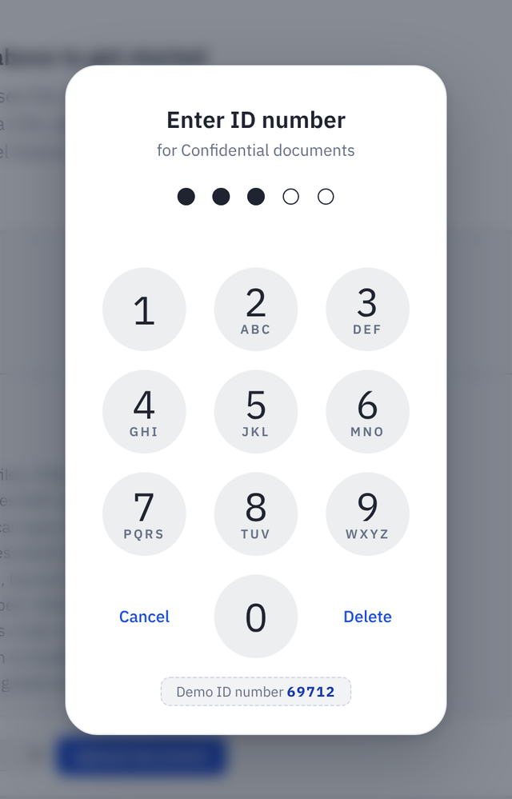
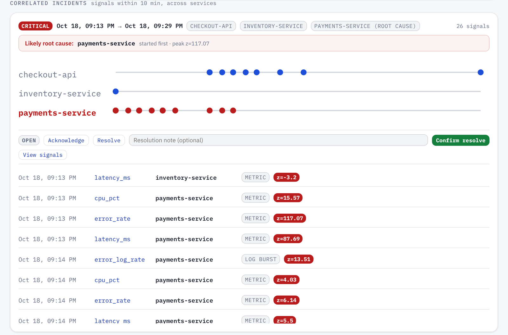
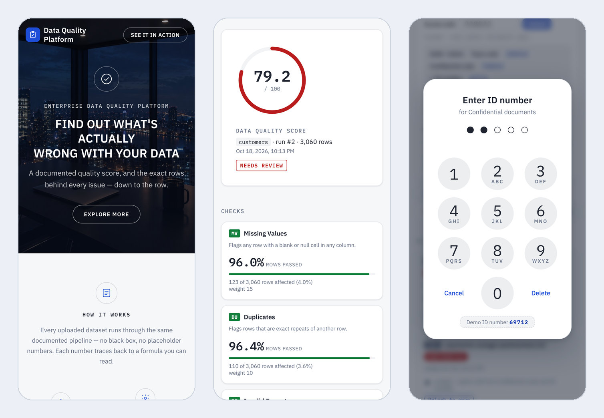

# Enterprise Data Quality Platform

Upload a CSV and find out what is actually wrong with it: a quality score you can explain, and the exact rows behind every issue. Eight data-quality checks, a document search that decides who may open what, and an incident page that works out which service most likely failed first.

<p align="center">
  
</p>

Built with FastAPI, SQLAlchemy and pandas; a front end of plain HTML, CSS and JavaScript (Chart.js draws the charts); SQLite by default or Postgres; tested with pytest.

## What's in it

- **Eight data-quality checks** that work on any CSV, with no setup per dataset: missing values, duplicates, invalid formats, outliers, unexpected values, schema changes, data drift and broken relationships between files. Click a check to see exactly which rows (or columns) it flagged.
- **A score with a formula behind it.** Each check has a weight, and the score is the weighted pass rate, so any number on the page can be explained. The demo data is generated with a known, counted set of problems, and a test checks that the platform finds them.
- **Knowledge Search.** Upload PDFs, Word files, CSVs or text, then search by keyword, by meaning, or both. Every document is public, team or confidential, and the *server* decides who may open it. Confidential takes a code *and* a five-digit ID, typed on a phone-style passcode pad.
- **Production Incident Intelligence.** Upload logs and service metrics. It flags anomalies and error bursts, groups related signals across services into one incident, and ranks which service started failing first.
- **Try a sample.** One click checks a made-up business dataset (orders, customers, employees, invoices, inventory or support tickets), so you can see it work without having a CSV.
- **Upload limits that were measured, not guessed.** Every upload has a cap, and this README lists the memory each one really used.

## Screenshots

### The dashboard



The seeded `customers` demo. Seven of the eight checks run on it (broken relationships needs a second file, so it shows on the `orders` demo). Schema changes and data drift compare this run with the one before it, and both are opened here to show what they found.

### Knowledge Search



Everything is listed and searchable; *opening* a document is what needs a code. Here a visitor with no code searches for "payment" and gets two matches shown as locked cards: a name and a level, nothing from inside. The [Demo codes box](#demo-codes-on-a-live-site) prints the codes so the lock is easy to try.

<p align="center">
  
</p>

The Confidential code is followed by this pad: five dots fill in as the digits go in, and the fifth one sends it.

### Production Incident Intelligence



The built-in demo: a payment-gateway outage that spreads into checkout. The signals are grouped into one incident, `payments-service` is ranked as the likely root cause because it started failing first, and the timeline shows the cascade. An incident can be acknowledged or resolved from the page.

### On a phone



## Run it locally (SQLite, no external services)

You need Python 3.12 or newer.

```bash
python -m venv venv && source venv/bin/activate
pip install -r requirements.txt

python -m scripts.seed_dataset        # writes data/customers_clean.csv, data/customers_seeded.csv, data/orders_seeded.csv
python -m pytest                       # all 8 checks, the API, seeded ground truth, access codes, upload limits, samples

uvicorn app.main:app --reload          # http://localhost:8000/          - the site
                                        # http://localhost:8000/docs      - interactive API docs
```

On the site, type `customers` as the label to see the seeded demo (two runs, so the schema and drift checks have something to compare), or press **Try a sample**.

Two things to know about the first run. `pip install` is the slow part, because `sentence-transformers` brings in PyTorch. And the first document upload or semantic search (and the first test run that gets that far) downloads a small search model, `all-MiniLM-L6-v2`, about 90 MB, which is then kept on disk. The tests use their own database file, `test_dqp.db`, never your real `dqp.db`.

Try it against the seeded file:

```bash
curl -F "file=@data/customers_seeded.csv" http://localhost:8000/datasets/customers/runs
```

Or with a relationship check against the seeded orders file, to see broken_relationships catch the
~3% of orders whose customer_id doesn't exist in customers:

```bash
curl -F "file=@data/orders_seeded.csv" \
     -F "reference_files=@data/customers_seeded.csv" \
     -F 'relationships=[{"column":"customer_id","reference_index":0,"reference_column":"customer_id"}]' \
     http://localhost:8000/datasets/orders/runs
```

## Status

**All 8 checks are implemented and live:** missing values, duplicates,
invalid formats, outliers, unexpected values, schema changes, data drift,
and broken relationships. Also done: scoring, the upload → check → score →
persist → query API flow, a multi-file upload path for cross-dataset
relationship checks, the seeded-dataset generator with a test that ties
check output to known ground truth, a full site (marketing page + embedded
live dashboard, served at `/`) with a score gauge, per-check drill-down, a
score-history chart, a self-seeding demo (across two related datasets, so
every check - including the ones that need history or a second dataset -
has something to show on first load), and a Render deploy blueprint.

See `app/checks/` for the pattern each check follows - a new check is a new
file there plus one line in `app/pipeline.py`, and it shows up on the live
site automatically, no frontend changes needed (this is exactly how checks
4-8 were added after the first 3).

**Not yet built:** anything past the original 8-check scope - e.g. a live
database connection instead of CSV upload, real auth/multi-tenant access
(Knowledge Search has shared access codes per level - see below - but no user
accounts), or richer drift measures (only numeric columns get PSI-based drift
today; categorical drift isn't implemented).

## Why it's built this way

- **Every check is a pluggable unit** (`app/checks/base.py`): takes a
  DataFrame + config, returns pass/fail, affected row count, and affected row
  keys. Scoring, persistence, and the API are all generic over this shape, so
  adding a new check never touches any of them - all 8 checks here follow
  the exact same contract, from the row-level ones (missing values) to the
  structural ones (schema changes) to the cross-dataset one (broken
  relationships).
- **It works on any CSV, not just the demo schema** (`app/profiling.py`):
  most checks need no configuration at all - missing-values and duplicates
  check every column / the whole row by default; outliers and unexpected
  values auto-select which numeric/categorical columns are worth checking
  based on how many distinct values they have. Format checking is
  auto-detected per dataset - a real `@`-format check for anything named
  like an email column, and a general structural-pattern detector for
  everything else, built from whatever shape most of a column's values
  already share (e.g. a consistent `SKU-0000` pattern). A column needs at
  least 5 values and a dominant shape covering 90%+ of them before it's
  trusted enough to format-check - below that (free text, or genuinely
  inconsistent data like phone numbers), it's correctly left alone instead
  of producing false positives. There's no config file to write per
  dataset; upload a CSV with a completely different schema and it just
  works.
- **Some checks need memory, not just the current upload.** Schema changes
  and drift compare this run's columns/distributions against the *previous*
  run for the same dataset name (`schema_snapshot` / `distribution_snapshot`
  on `CheckRun`) - drift specifically uses the Population Stability Index,
  the standard measure for this in production ML/data systems, binning the
  current data into the previous run's own decile edges. Broken
  relationships needs a *second* dataset, not history - so it's the one
  check triggered by uploading an extra reference file alongside the main
  one (see the API table below), checked in-memory and never persisted, the
  same way every other check never persists raw rows either.
- **The score is a documented formula, not a vibe**: each check category has
  a weight (`app/scoring.py`), the score is the weighted sum of each check's
  pass rate, normalized by the weight of checks that actually ran. That's
  what lets you explain any number this produces.
- **The demo numbers are real.** `scripts/seed_dataset.py` generates a clean
  synthetic dataset, then injects a known, counted set of issues into a copy.
  Ground truth is measured from the final corrupted data (not bookkept
  through the mutation steps — those can interact, e.g. a row that loses its
  email can also get duplicated), so it can never drift from reality.
  `tests/test_checks/test_seeded_dataset.py` asserts the checks agree with it.

## Knowledge Search access codes

Documents in Knowledge Search are saved as **public**, **team** or **confidential**. **Everything is listed and searchable; opening a document is what needs the code.** The page sends the code with every request (the `X-Access-Code` header, plus `X-Access-Id` for Confidential) and the **server** checks it - hiding a card in the page is never the only protection.

| You enter | You can open |
|---|---|
| nothing | public documents |
| the team code | public + team |
| the confidential code **and** the 5-digit ID number | public + team + confidential |

Confidential is a two-part key. After you enter the confidential code, the page shows a passcode pad like a phone's: five dots that fill in as you press the number keys (or type the digits), with the fifth digit sending it. A wrong ID shakes the dots, empties them and uses up one of the same three tries; **Cancel** (or Escape) closes the pad and unlocks nothing. The server needs both halves: the confidential code on its own, sent to the API without the ID, opens public and team documents but never confidential ones.

A document above your code still turns up in the list and in search results, as a **locked card**: its name, type, level and date, a padlock, and an **Unlock to open** button - and nothing from inside it (no text, excerpt, size, score or history; the server doesn't send any). Type that level's code on the card and it unlocks and opens in one step, from the list or from a search result (for Confidential, the ID pad comes up after the code).

On the page, the **Access code** box unlocks a code (it's held in the page's memory only - nothing is saved in the browser, so a refresh starts locked again and you type the code in again). **Three wrong codes or IDs switch code entry off until you refresh the page** (the box, the Unlock buttons, the Demo codes chips and the pad's keys all go grey, with a message saying so), and the **Viewing as** dropdown previews what a lower level sees. Click any document you can open - text as text, a CSV as a table you can page through and download. Ticking **Save this check and its data to Knowledge Search** on a run saves the summary report *and* the rows you uploaded, both at the level you pick, so whoever holds that level's code can open the data.

The demo defaults are `TEAM_ACCESS_CODE=280010`, `CONFIDENTIAL_ACCESS_CODE=938032` and `CONFIDENTIAL_ID_NUMBER=69712`, and a **Demo codes** box on the page prints them, so a visitor can try each level straight away (`SHOW_ACCESS_HINT=true`; the ID number is shown next to the Confidential code only, and again on the pad itself). The ID number must be exactly 5 digits (the pad has five dots); the app refuses to start with anything else, blank included, and says why. What to do with all this on a public site is in [Demo codes on a live site](#demo-codes-on-a-live-site), at the end of this section.

Worth knowing:

- It's a shared code per level, not user accounts: anyone who knows a code can open that level (for Confidential, the code and the one shared ID number). The page gives a visitor three wrong codes or IDs and then stops accepting them until the page is refreshed (a refresh starts over - the count lives in the page's memory, like the code itself; a valid code for the wrong level, a blank box or an unreachable server don't use a try). That slows a person down; it is **not** a limit the server enforces. The server doesn't count attempts, so a script calling `POST /documents/access/unlock` directly can still guess. The code is checked before the ID (the page needs to know the code is right before it shows the pad), so the guesses add up (about a million codes, then 100,000 IDs) rather than multiply. A real public site should also rate-limit that endpoint per IP address (at a proxy, or in the app).
- Search can reveal that a locked document matches. A locked result carries no text, but *that it matched* is visible, so someone without the code could probe what's inside a confidential document by trying searches. Likewise a locked card shows the file name, so don't put secrets in file names. If that trade-off isn't acceptable, the stricter option is to match locked documents on their file name only (a small change in the keyword and semantic matching in `app/routers/documents.py`).
- Only *opening* is gated. Anyone can upload a document or save a report at any level; they just can't open it again without the code.
- Older versions of a document keep the level they were saved with.
- The dashboard's per-check drill-down (the affected row keys) is still public.
- Saved rows are found by keyword search, not by meaning (they aren't embedded - thousands of table rows aren't worth the time).

### Demo codes on a live site

The codes are on the page on purpose. This is a portfolio demo, and someone who opens the link should be able to try Team and Confidential access in ten seconds instead of hunting for a code. They protect nothing real, and the page says so: *"These demo codes are visible to everyone, so don't upload anything private here."* The live site is meant to hold sample data only, and on Render's free plan its disk is temporary, so whatever visitors upload doesn't stay for long. Visitors can also clear the sample incident logs with the **Delete all logs** button, which is fine for a demo (the sample data is added again the next time the service starts with no logs stored).

That is the default, so a deploy with no settings is the open demo. If real documents will ever go on the site, lock it down instead:

| | Open demo (the default) | Locked down |
|---|---|---|
| Settings | none | your own `TEAM_ACCESS_CODE`, `CONFIDENTIAL_ACCESS_CODE` and 5-digit `CONFIDENTIAL_ID_NUMBER`, plus `SHOW_ACCESS_HINT=false` |
| Demo codes box | shown | hidden, and `GET /documents/access/hint` answers `{"enabled": false}` |
| Fine for | a public portfolio link with sample data | a site where people may upload real files |

Set them in `.env` locally, or as environment variables on the host (on Render, in the service's Environment settings). Locked down is still one shared code per level, not user accounts, and the 3-tries limit lives in the page, so a real public site should also rate-limit `POST /documents/access/unlock` (see *Worth knowing* above).

## Production Incident Intelligence
The second page of the site (linked from the dashboard) answers "what just broke, and where did it start?". Upload application logs (`timestamp, service, level, message`) and service metrics (`timestamp, service, metric_name, value`) as CSV. A three-service demo - a payment-gateway outage that cascades into checkout - is seeded on first start, so there is something to explore straight away.

- **Anomalies.** Every metric is compared with its own recent trailing baseline, per service and metric; a point more than 3σ away is flagged (`app/anomaly_detection.py`).
- **Error bursts.** ERROR and CRITICAL log lines are counted per minute per service and tested the same way (`app/log_burst_detection.py`).
- **Correlation.** Signals within 10 minutes of each other, across services, become one incident, so a payments outage and the checkout errors it causes a few minutes later show up as one incident, not two unrelated blips (`app/incident_correlation.py`).
- **Root cause.** Within an incident, services are ranked by which one started failing first. That is the usual first heuristic before anyone has done a real investigation, not a proof (`app/root_cause_ranking.py`).
- **Severity and tracking.** Each incident is classified critical, warning or info from its peak severity, its duration and whether it spread across services (`app/incident_severity.py`). It can be acknowledged or resolved with a note, and the mean time to resolution is tracked across the closed ones.

## Try a sample, and upload limits

**Try a sample.** No CSV handy? The **Try a sample** button next to *Run check* makes a random made-up business dataset (online store orders, customers, employees, supplier invoices, warehouse inventory or support tickets - a couple of thousand rows each, with everyday problems mixed in: blank emails, duplicates, odd dates, typos, amounts with a zero too many), checks it exactly as if you had uploaded it, and shows the results. A bar under the upload form then offers **View data** (the first 100 rows as a table) and **Download CSV** (all of it). Pressing the button again never gives the same kind twice in a row.

- Nothing is stored for a sample except its run: it's generated on request (`app/sample_datasets.py`) and checked under the label `sample-<kind>` (e.g. `sample-orders`) like any dataset, so it has a score, history and drill-down. Only the latest 10 runs of each sample label are kept, so pressing the button all day doesn't fill the database.
- Each kind is built so the checks find the problems it promises and *nothing else*: `tests/test_samples.py` runs the real checks over every kind and fails if a column that was meant to be clean gets flagged.
- API: `GET /samples` (the kinds), `GET /samples/random?exclude=<kind>`, `GET /samples/<kind>?seed=<n>` (the same seed always gives the same file).

**Upload limits.** One huge file - or a small one that is huge once it's opened (a zip bomb, a CSV with a million columns) - can use up the server's memory and take the site down for everyone, so every upload has a cap. Going over one is a plain **HTTP 413** with a message that says what to do (`'big.csv' is 26.3 MB - over the 25 MB limit for one file. Try a smaller file.`), and the page checks file sizes itself before it uploads anything (it asks `GET /limits` for the numbers, so the two always agree). The limits are in `app/limits.py`; each is an environment variable:

| Setting | Default | What it stops |
|---|---|---|
| `MAX_UPLOAD_MB` | 25 | one file bigger than this. Also the most one request may carry (a file plus room for its form fields): refused from its `Content-Length`, or - if it doesn't say - as soon as too many bytes have arrived |
| `MAX_CHECK_ROWS` | 1,000,000 | a CSV with more rows (only the first rows up to the limit are ever parsed, to find out). A 25 MB file only gets near this if its rows are about 26 bytes long; an ordinary export has about 200,000 |
| `MAX_CHECK_COLUMNS` | 100 | a very wide CSV (found from its header alone) |
| `MAX_CHECK_CELLS` | 6,000,000 | rows × columns, which is what memory really scales with |
| `MAX_REFERENCE_FILES` | 3 | related files for the relationship check, in one run. Only the column a rule looks things up by is read from each, so a related file costs a fraction of its size |
| `MAX_INCIDENT_ROWS` | 25,000 | rows in one logs or metrics upload |
| `MAX_DOCUMENT_CHUNKS` | 1,000 | a document too long to index for search (about 120,000 words). Plain text that could never fit is turned away before it is even read. A Word file is refused if everything inside it unpacks to more than twice the file limit, or if its text parts alone unpack to more than 10 MB (text costs about ten times its size to open; pictures cost about their size) |
| `MAX_CONCURRENT_UPLOADS` | 2 | uploads being worked on at the same moment - checks, document uploads, and saving a check's rows to Knowledge Search: extra ones wait their turn, and get a "server busy" 503 if that takes more than 20 seconds |

These numbers were measured, not guessed. Each row below is a 25 MB upload sent to a real server (idle: about 140 MB, search model not loaded) on a 2-core test machine, and is the extra memory the server held while it worked:

| Upload | Extra memory | Time |
|---|---|---|
| An ordinary file (205,000 rows × 11 columns) | about 105 MB | 6 s |
| The same size where every row fails several checks | about 85 MB | 5 s |
| 760,000 short rows | about 125 MB | 8 s |
| 5.2 million cells of numbers (131,000 rows × 40 columns) | about 100 MB | 9 s |
| 1,000,000 short rows, every one flagged three ways (the heaviest shape the limits let in) | about 195 MB | 22 s |
| A file plus three related 25 MB files | about 170 MB | 8 s |
| Two ordinary files at the same moment | about 205 MB | 13 s |
| Two of "a file plus three related files" at the same moment | about 325 MB | 17 s |
| Two of the 1,000,000-row case at the same moment | about 380 MB | 30-46 s |
| Three at once (the third waits for a place) | about 225 MB | 20 s |

So the most one visitor can make the server hold at once is about 380 MB on top of idle - fine on a laptop or a host with a gigabyte or two to spare. Before these limits a 5.8 MB file where every row failed several checks added almost 490 MB (the database layer built one object per flagged row); flagged rows are now saved in batches, which keeps that cost flat however many rows there are. Other uploads: a 23.5 MB PDF adds about 25 MB; a 24 MB text file, or random bytes named `.csv`, are turned away for about 25 MB; a 22 MB Word file that is mostly photos opens for about 35 MB; a Word file with more than 10 MB of text is refused in a tenth of a second. Saving a 24 MB check's rows to Knowledge Search, then listing, searching, opening and re-saving them, takes under 1.5 s a step and at most about 75 MB (about 300 MB in the extreme case where every row holds an emoji, which Python stores at four bytes a character).

**On a small host, lower them.** Render's free plan has 512 MB in total and most of it goes to the search model once it loads, so use `MAX_UPLOAD_MB=5`, `MAX_CHECK_ROWS=30000`, `MAX_REFERENCE_FILES=1` and `MAX_CONCURRENT_UPLOADS=1` there: the same tests then add about 30 MB for a file plus a related file, and about 60 MB with four visitors uploading at once. The Render blueprint (`render.yaml`) sets exactly these for its free plan; take the `envVars` block out when you move to a plan with more memory, and the 25 MB defaults apply again.

Not covered: the incident tables aren't capped in aggregate (several uploads add up, and `/incidents/correlated` reads all of the rows); a specially crafted PDF can still be expensive to read (Word files are checked for this); the 3-tries limit on the access codes is in the browser, not the server; and with SQLite - the default database - one big file's flagged rows are written one writer at a time, so for up to about 20 seconds in the extreme case other visitors' requests wait for the write instead of failing (Postgres, in `docker-compose`, doesn't have this).

## Run it with Postgres (closer to prod)

```bash
cp .env.example .env
docker compose up --build
```

## Deploying it live

Deployed as a single Render web service, built from the Dockerfile:

1. Push this repo to GitHub.
2. On [Render](https://render.com), New → Blueprint, point it at the repo. It reads `render.yaml` and provisions the web service automatically. (Or New → Web Service manually, runtime: Docker, if you'd rather not use the blueprint.)
3. Free plan is fine. First deploy takes a few minutes to build the image.

No database service is provisioned on purpose - the app defaults to SQLite and **self-seeds a demo run on startup if the database is empty** (see `seed_demo_data_if_empty()` in `app/main.py`). That means:

- A fresh deploy shows a populated dashboard immediately, not an empty state.
- Render's free web services have an ephemeral disk and sleep after 15 min idle - if a restart wipes the SQLite file, the app just reseeds itself on the next boot. Nothing to babysit.
- If you want a real persistent Postgres instead (to actually demonstrate wiring up an external DB, or just to stop it resetting), add a `databases:` block to `render.yaml` and set `DATABASE_URL` as an env var - `app/config.py` already reads it, no code change needed. Just know Render's free Postgres expires after 30 days; the cheapest paid tier is $6/mo after that.
- With no settings, the site is the open demo: the Demo codes box is shown and the codes are the defaults. See [Demo codes on a live site](#demo-codes-on-a-live-site) for locking it down.
- The trade-off either way: free tier means occasional 30-60s cold starts after idle time. Normal for a portfolio demo, worth knowing before a recruiter clicks the link expecting instant load.

## API

| Endpoint | What it does |
|---|---|
| `POST /datasets/{name}/runs` | Upload a CSV (`file`; up to `MAX_UPLOAD_MB` and the row / column limits above - over them it's a 413 that says which), run all checks, persist and return the scored result. Optionally attach `reference_files` (one or more) plus a `relationships` JSON field (`[{"column", "reference_index", "reference_column"}, ...]`) to also run broken_relationships against them - the response's `relationship_feedback` reports exactly what happened with each rule (applied, with counts, or skipped, with why). |
| `GET /datasets/{name}/runs` | List past runs for a dataset, most recent last |
| `GET /datasets/{name}/runs/{run_id}/issues/{check_name}` | The specific row keys (or, for schema_changes/drift, the human-readable change descriptions) that failed a given check. `count` is how many there are; `row_keys` lists the first `limit` of them (default 5,000, at most 100,000 - a check on a big file can flag a million rows; the dashboard asks for 50, which is all it shows) |
| `POST /datasets/{name}/runs/{run_id}/knowledge-report` | Save a text summary of one run (score, per-check results, column names - never row values) to Knowledge Search. Form field `access_level` (`public`, `team` or `confidential`; default `team`). Attach the CSV the check ran on as `data_file` (up to 25 MB) and its rows are saved too, as a second document (`quality-data-<label>.csv`) at the same level; if only the rows can't be saved the report still is, and the response says why (`data_error`). One document per dataset label, so saving later runs adds new versions. The dashboard's "Save this check and its data to Knowledge Search" checkbox calls this after a run. |
| `GET /documents`, `GET /documents/search`, `GET /documents/semantic-search`, `GET /documents/hybrid-search` | The document list and the three searches (`q`, plus `role`) cover **every** latest document. One the caller may open comes back in full with `"locked": false`; one above the caller's level comes back as `"locked": true` with only `id`, `filename`, `content_type` and `access_level` (the list adds `version` and `uploaded_at`) - no text, excerpt, size or score. |
| `POST /documents` | Upload a PDF, Word file, CSV or text file (`file`, plus `access_level`: `public` (the default), `team` or `confidential`). Re-uploading a filename saves a new version instead of overwriting the old one. |
| `GET /documents/{id}`, `GET /documents/{id}/history` | Open one document, or list every version saved under its filename. Above the caller's level the first is a 403, and the history leaves those versions out. |
| `GET /documents/analytics/summary`, `DELETE /documents/search-logs` | Search volume by mode, the most frequent queries and the ones that came back empty; and clearing the log. Team or Confidential code only. |
| `POST /documents/access/unlock` | JSON `{"code": "...", "id": "..."}` (`id` only matters for the confidential code) - a correct code returns `{role, level, needs_id}` (what it opens). The confidential code **without** its `id` returns the team level with `needs_id: true` (the page then opens the ID pad); with the right `id` it returns the confidential level. 403 for a wrong code or a wrong ID. What the page's Unlock button and ID pad call; nothing is stored server-side. |
| `GET /documents/access/hint` | The two demo codes and the ID number, for the page's Demo codes box - or `{"enabled": false}` (all three `null`) when `SHOW_ACCESS_HINT=false`. |
| `GET /documents/{id}/table` | A CSV document as `{columns, rows, total_rows, offset, limit}`, a page at a time (`offset`, and `limit` up to 500). Same access rule as opening the document. |
| `POST /incidents/logs/upload`, `POST /incidents/metrics/upload` | Upload a logs CSV (`timestamp, service, level, message`; level is INFO, WARN, ERROR or CRITICAL) or a metrics CSV (`timestamp, service, metric_name, value`). Up to `MAX_INCIDENT_ROWS` rows each. |
| `GET /incidents/services`, `/incidents/logs`, `/incidents/metrics` | The services seen, and the stored log lines and metric points, newest first (`service`, `level` / `metric_name` and `limit` narrow them). `DELETE /incidents/logs` clears every log line. |
| `GET /incidents/anomalies`, `GET /incidents/log-bursts` | Metric points, and per-minute ERROR/CRITICAL bursts, that are statistical outliers against their own trailing baseline. |
| `GET /incidents/correlated` | Anomalies and bursts merged across services into incidents, each with a severity and a ranked root cause. `POST /incidents/correlated/{id}/acknowledge`, `/resolve` (with a note) and `/reopen` track one; `GET /incidents/history/summary` gives the counts by status and the mean time to resolution. |
| `GET /samples`, `GET /samples/random`, `GET /samples/{kind}` | The "Try a sample" datasets: the kinds; a random one (`exclude=<kind>` skips the kind just shown); one kind (`seed` makes it repeatable). Each comes with the full CSV, its columns, its first 100 rows and the label to check it under. |
| `GET /limits` | The upload limits (`max_upload_bytes`, `max_check_rows`, ...), so the page checks files against the same numbers as the server |
| `GET /health` | Liveness check |

The `/documents` endpoints that list, search, open or show history/analytics take `role` (`employee`, `manager` or `admin` - public, team, confidential) plus the `X-Access-Code` header (and `X-Access-Id` for Confidential); asking for a role above public without its code - or, for `admin`, without the ID number as well - is a 403. Listing and searching never refuse for a document's level (they lock it instead), but opening one (`GET /documents/{id}`, `/table`, `/history`) above the caller's level is a 403.

## Project layout

```
app/
  checks/        one file per check (all 8), each implementing BaseCheck
  routers/       API routes
  pipeline.py    builds each run's check list from whatever the dataset + request actually contain
  profiling.py   auto-detects which columns each check applies to, for any CSV schema
  scoring.py     the weighted score formula
  limits.py      the upload limits: request-size middleware, row / column / cell caps, upload slots
  sample_datasets.py   the made-up business datasets behind "Try a sample"
  models.py      SQLAlchemy tables: datasets, check_runs (+ schema/distribution snapshots), check_issues
  static/        the site: marketing page + embedded dashboard (index.html, app.js, style.css)
scripts/
  seed_dataset.py   generates the clean + corrupted customers data, and the related orders data
tests/
  test_checks/      one test file per check, plus the seeded-ground-truth test
  test_api.py       end-to-end tests through the actual API
docs/
  screenshots/      the pictures in this README, taken from the running app
Dockerfile, docker-compose.yml, render.yaml   the container, local Postgres, and the Render blueprint
LICENSE
```

## License

[MIT](LICENSE): use it, change it, learn from it.

## Credits

- Hero picture: generated with ChatGPT for this project.
- Typeface: [IBM Plex](https://www.ibm.com/plex/) Sans and Mono (SIL Open Font License), loaded from Google Fonts.
- Charts: [Chart.js](https://www.chartjs.org/) (MIT), loaded from cdnjs.
- Search by meaning: the [all-MiniLM-L6-v2](https://huggingface.co/sentence-transformers/all-MiniLM-L6-v2) model, run through [sentence-transformers](https://www.sbert.net/) (both Apache 2.0).
- Made-up data: [Faker](https://faker.readthedocs.io/) (MIT).
- Built on [FastAPI](https://fastapi.tiangolo.com/), [SQLAlchemy](https://www.sqlalchemy.org/), [pandas](https://pandas.pydata.org/) and [pytest](https://pytest.org/).

Created by [CodedByMikeW](https://github.com/CodedByMikeW).
